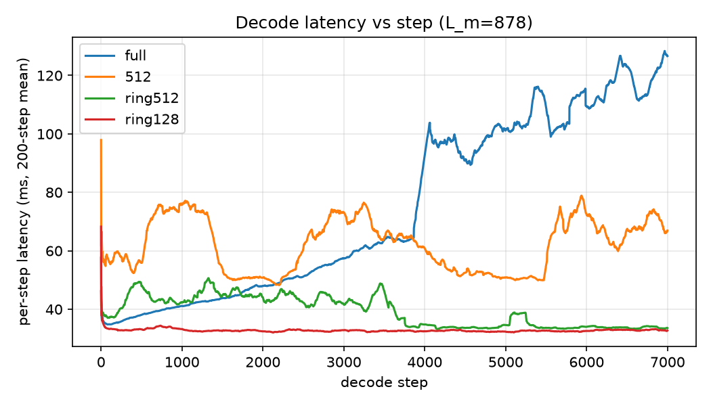
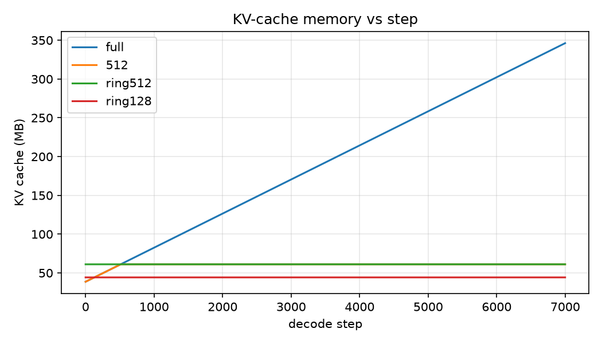

# Results: Unlimited-OCR-Lite

Model: `ibm-granite/granite-docling-258M` (258M parameters), **CPU only** (Intel Core Ultra 5 225H,
15 GB RAM, fp32). R-SWA is applied **at inference time, without retraining**.
Full tables: `docs/figures/*.md`. Raw outputs: `outputs/`.

---

## Point 1: VLM OCR pipeline (multi-page, long-horizon)

**Pipeline:** PDF/page images → VLM → DocTags → Markdown. It works end to end (example:
`outputs/unlimited_ocr_paper_p1-1_page_full.md`, about 48 s per page on CPU) and handles
multi-page documents page by page.

**One-request multi-page experiment** (`docs/figures/multipage_results.md`): documents of 2,
4 and 8 pages built from OmniDocBench book and academic pages, all at 1024 px (about 340
prefix tokens per page, like the paper's "Base" mode).

| Pages | Mode | Text ED ↓ | Peak KV MB |
|---|---|---|---|
| 2 | page-wise | 0.705 | 125 |
| 2 | one request, full attention | 0.835 | 242 |
| 2 | one request, R-SWA n=512 | 0.639 | **52** |
| 4 | page-wise | 0.619 | 125 |
| 4 | one request, full attention | 0.760 | 499 |
| 4 | one request, R-SWA n=512 | 0.747 | **82** |
| 8 | page-wise | 0.563 | 125 |
| 8 | one request, full attention | 0.757 | 376 |
| 8 | one request, R-SWA n=512 | 0.911 | **140** |

**Takeaways**
- **Page-wise is the reliable mode** for this model. One request over many pages works
  mechanically (the model reads several images and emits `<page_break>`), but it was trained
  only on single pages. It **stops early and skips pages**: an 8-page document gets about
  4–6k tokens instead of about 15k, with only 1–3 of 7 page breaks.
- **Resolution matters most:** at 1024 px the same pages that score about 0.00 text error
  at full resolution score 0.3–0.7, and 8 of 16 pages ran into the 2,500-token cap (the
  model loops on tables). The paper reports the same cause for its multi-page errors: Base
  mode resolution.
- **R-SWA's memory advantage holds for multi-page input** (52–140 MB vs 156–499 MB).
- Full attention went **past the 8,192-token trained context** (up to 11,347 positions);
  the paper trained at 32K to support this.

## Point 2: R-SWA

- Implemented two ways: simple cat-and-evict (`trim_cache`) and an optimized preallocated
  **ring buffer** (`RingRSWALayer`), in `uocr_lite/rswa.py`.
- **Correctness** (`tests/test_rswa.py`, 4 tests, all pass):
  1. infinite window = full attention, token for token;
  2. the cache never exceeds L_m + n, and the output equals full attention until the first eviction;
  3. the cache decode matches a forward pass with the explicit R-SWA mask to within 1e-4
     (negative control: off by up to 35 logits against a full-attention mask);
  4. ring buffer = simple version, token for token, with constant memory.

## Point 3: long-context inference (7,000 tokens, 3 repeats, `docs/figures/profile_summary.md`)

| Setting | Decode tok/s | ms/token at start → end | Peak KV |
|---|---|---|---|
| Full attention | 11.8 ± 1.2 | 48 → **130** (keeps growing) | **346 MB** |
| R-SWA n=512, simple cache | 16.1 ± 0.2 | 55 → 66 | 61 MB |
| R-SWA n=512, **ring** | **28.1 ± 2.2** | 35 → **34 (flat)** | 61 MB |
| R-SWA n=128, **ring** | **30.6 ± 0.1** | 33 → **32 (flat)** | 44 MB |

**Takeaways**
- Full attention: per-token latency grows about 3.7× over 7k tokens (there's a jump near
  step 4,000), and memory grows linearly at 46 KB per token.
- R-SWA with the ring cache: **constant latency and constant memory**. It's **2.4× faster**
  than full attention and **5.7× less KV memory**.
- The ring buffer is **1.7× faster than the simple R-SWA cache**: copying the cache every
  step was the bottleneck.
- Analytical cost (`complexity.png`): attention per token is O(L_m + t) for full attention
  and O(L_m + n) for R-SWA.

## Point 4: evaluation (OmniDocBench, 56 English pages, 7 document types)

| Setting | Text ED ↓ | TEDS ↑ | Formula ED ↓ | Order ED ↓ | Layout F1 ↑ | Distinct-35 ↑ | Overall* ↑ |
|---|---|---|---|---|---|---|---|
| Full attention | **0.143** | **54.2** | **0.177** | **0.062** | **61.3** | 98.2 | **74.0** |
| R-SWA n=512 | 0.312 | 45.5 | 0.444 | 0.161 | 49.5 | 95.1 | 56.6 |
| R-SWA n=256 | 0.377 | 44.1 | 0.546 | 0.209 | 42.0 | 96.2 | 50.6 |
| R-SWA n=128 | 0.540 | 40.0 | 0.673 | 0.191 | 34.9 | 98.2 | 39.6 |

Overall* = mean(100·(1 − Text ED), TEDS, 100·(1 − Formula ED)), using formula edit
distance in place of CDM.

Full attention by document type: books are best (text ED 0.03, TEDS 94); newspapers are
hardest (text ED 0.23, reading-order ED 0.22, because of multi-column layouts). Layout F1:
table 81, formula 69, title 69, figure 63, text 59.

**Takeaways**
- **Without retraining, R-SWA trades accuracy for memory.** The smaller the window, the worse
  the result (Overall* 74 → 57 → 51 → 40).
- **Failure mode (diagnosed):** outputs change right after the window fills (around token
  550–790 for n=512). The model can no longer see what it wrote earlier, **loses its place**
  and re-transcribes paragraphs. Pages that hit the 6k-token cap: 2 → 8.
- This is why the paper **continues training the model with R-SWA**; retraining was out of
  scope for a CPU replication. On pages shorter than the window, R-SWA is identical to full
  attention.

## Limitations

- A 258M model on CPU, not the paper's 3B model on GPUs; R-SWA without retraining.
- 56-page subset, English only; formula edit distance instead of CDM.
- Multi-page documents are synthetic (concatenated pages), and that test ran at 1024 px.
